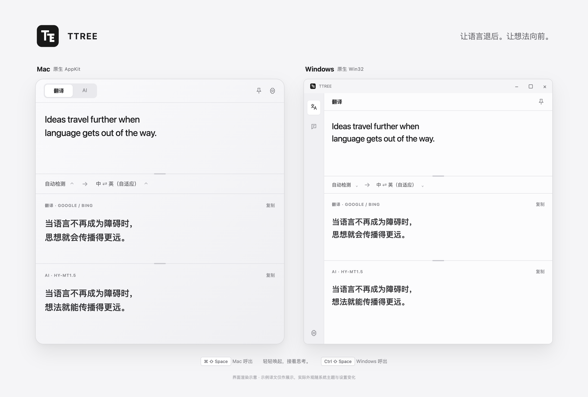
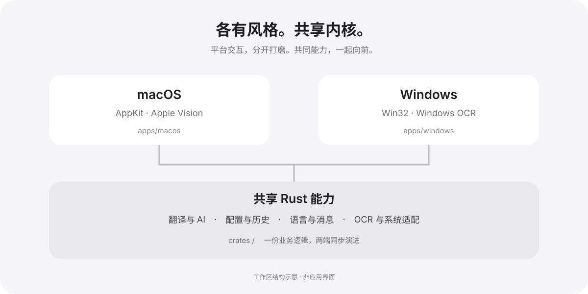

<p align="center"></p>
<h1 align="center">TTREE</h1>
<p align="center"><strong>让语言退后。让想法向前。</strong></p>
<p align="center">翻译。截图识字。与 AI 对话。<br>轻轻唤起，接着思考。</p>
<p align="center"><a href="https://github.com/ZASENJC/ttree/releases/latest">下载正式版</a> · <a href="https://github.com/ZASENJC/ttree/releases">探索新版本</a> · <a href="docs/development.md">参与开发</a></p>

<p align="center"></p>
<p align="center"><sub>macOS 与 Windows · 界面渲染示意</sub></p>

## 一个快捷键，回到心流。

阅读到一半，遇到另一种语言。选中它，或截下它。TTREE 随即出现，把译文带到眼前。按下 Esc，继续刚才的事。

默认使用 **⌘ ⇧ Space**（Mac）或 **Ctrl ⇧ Space**（Windows）呼出。窗口隐藏时，仍在等待下一次需要。

## 看得懂。也聊得开。

**文字，从画面里走出来。** 按下 **⌘ ⇧ S** 或 **Ctrl ⇧ S**，框选屏幕上的文字，识别后接着翻译。Mac 使用 Apple Vision；Windows 使用系统 OCR。

**两份译文，一眼对照。** Google 与 Bing 提供免费翻译，遇到服务异常自动切换。打开 AI 翻译，还能在同一个窗口里比较另一种表达。

**顺着想法，聊下去。** 切换到 AI 对话，保留上下文，继续追问。翻译与对话各自拥有模型和提示词设置。

**模型，由你选择。** 连接 OpenAI 兼容服务、Ollama 或本地模型服务；也可按需下载内置 HY-MT 翻译模型。模型文件独立下载，不占用安装包。

## 两个平台。一样顺手。

Mac 的轻盈，Windows 的熟悉。各自使用原生窗口和控件，共享翻译、对话与历史记录逻辑。

| | macOS | Windows |
| --- | --- | --- |
| 原生界面 | AppKit · 系统毛玻璃 | Win32 · 系统明暗主题 |
| 截图识字 | 原生自由框选 + Apple Vision | 原生框选 + Windows OCR |
| 划词翻译 | Accessibility，必要时回退复制 | 临时复制并恢复剪贴板 |
| 下载 | Universal DMG · Apple 芯片与 Intel | x64 ZIP · 解压即用 |



## 准备好，开始。

### 在 Mac 上

1. [下载最新正式版](https://github.com/ZASENJC/ttree/releases/latest)中的 `TTREE_*_universal.dmg`，将 TTREE 拖入“应用程序”。
2. 首次打开若被拦截，进入 **系统设置 → 隐私与安全性 → 仍要打开**。
3. 使用截图翻译时，授予 **屏幕与系统音频录制** 权限，随后完全退出并重新打开 TTREE。划词翻译可按需授予 **辅助功能** 权限。

Mac 发行包沿用固定社区证书签名，尚未经过 Apple 公证。同一证书用于后续升级，以维持录屏权限身份。旧临时签名版本迁移时，可能需要重新授权一次。

### 在 Windows 上

1. 下载 `TTREE_*_windows_x64.zip`，解压到固定目录。
2. 运行文件夹里的 `TTREE.exe`。窗口默认隐藏，按 **Ctrl ⇧ Space** 呼出，也可使用托盘菜单。
3. OCR 需要系统安装相应语言的文字识别组件；缺少语言时按应用提示补充。

Windows 包为未使用商业证书签名的便携版，首次运行可能遇到 SmartScreen 提示。请核对下载来源及附件 `SHA256SUMS`。启用开机自启后，请保留解压目录。

### 几个顺手的动作

| 动作 | Mac | Windows |
| --- | --- | --- |
| 呼出 / 收起 | ⌘ ⇧ Space | Ctrl ⇧ Space |
| 截图翻译 | ⌘ ⇧ S | Ctrl ⇧ S |
| 发送 / 翻译 | Enter | Enter |
| 换行 | Shift + Enter | Shift + Enter |
| 收起窗口 | Esc | Esc |

AI 对话、划词翻译、划词 AI 的快捷键可在设置中配置。点按置顶，让窗口留在身边。

## 给创作者，留好空间。

一个 Cargo 工作区，两套原生界面。共享功能修改一次；平台交互在各自目录里打磨。

```text
apps/macos/       Mac 界面与交互
apps/windows/     Windows 界面与交互
crates/           翻译、AI、配置、历史、OCR 与系统适配
scripts/macos/    Mac 打包与签名
scripts/windows/ Windows 打包与启动验证
scripts/release/ 双平台发布与附件校验
docs/            开发、发布说明与图片
```

开发入口：`cargo run -p ttree-macos -- --show`（Mac），`cargo run -p ttree-windows -- --show`（Windows）。完整依赖与检查命令见[开发指南](docs/development.md)。

推送到 `main`，自动构建两个平台并发布预发布版；推送匹配工作区版本的 `vX.Y.Z` 标签，验证后发布正式版。其他分支与 PR 只验证。[查看发布流程](docs/releasing.md) · [查看构建状态](https://github.com/ZASENJC/ttree/actions/workflows/build.yml)。

<sub>免费翻译依赖非官方端点，可用性取决于服务。离线模型需单独下载，并满足对应硬件与模型许可条件。配置与对话历史保存在本机；当前 API Key 随本机 JSON 配置保存，请勿分享配置文件。纯 Rust 版本目前通过下载 Release 手动升级；发布保留旧版更新客户端所需的签名附件。macOS 包声明最低系统版本为 11.0；Windows 提供 x64 构建。MIT 开源，第三方图标许可见 assets/licenses。</sub>
